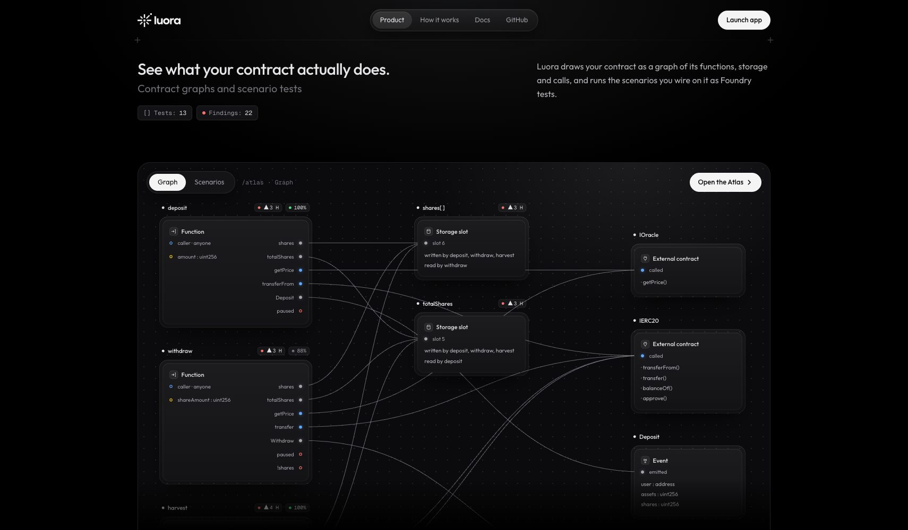
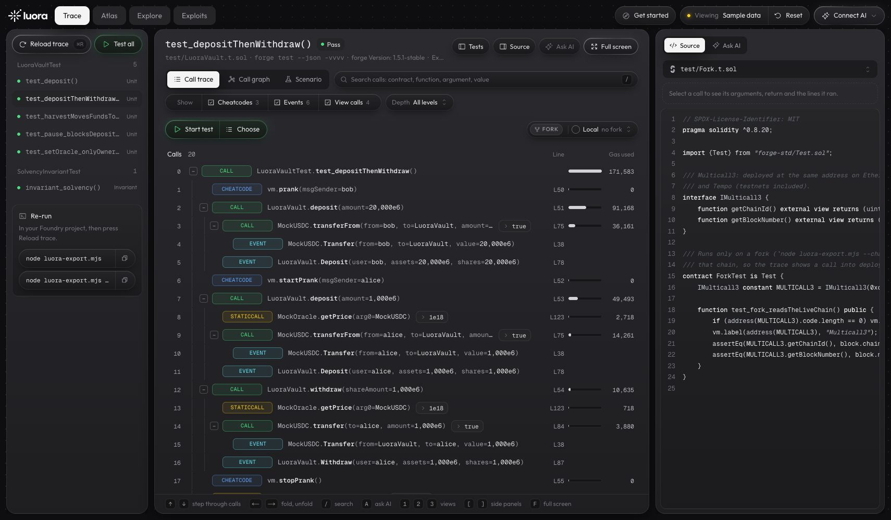
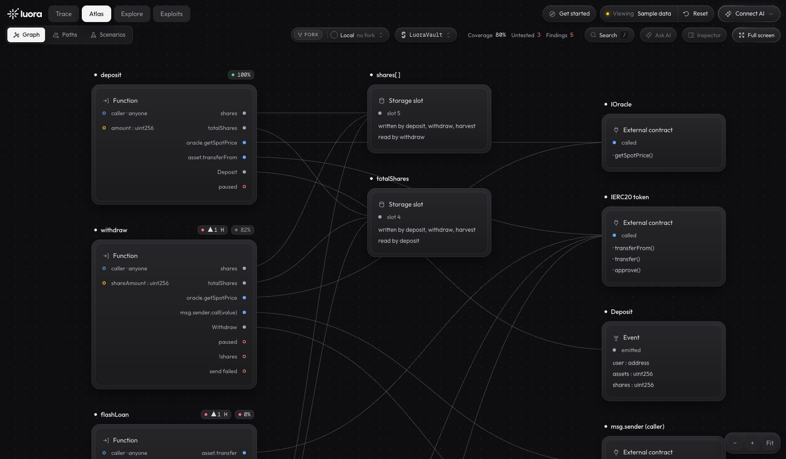
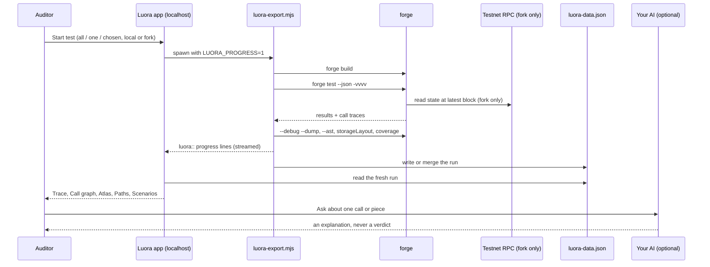
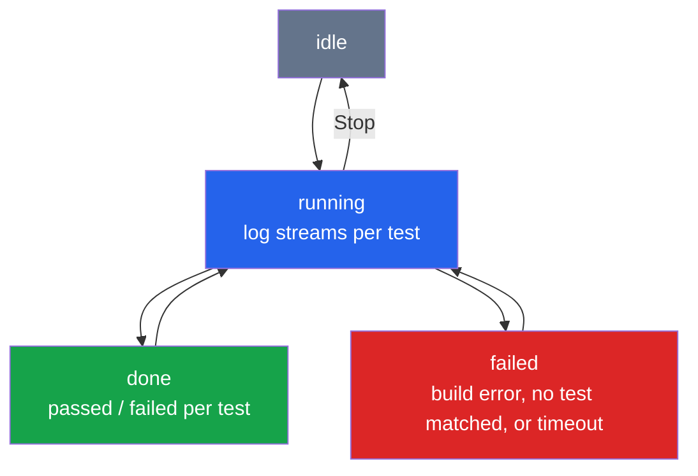

<p align="center">
  
</p>

<h1 align="center">Luora</h1>

<p align="center">
  See what your smart contract actually does. Your Foundry tests, decoded line by line, mapped as a graph, and checked by a human. AI explains. You judge.
</p>

<p align="center">
  <a href="https://luorasec.xyz"></a>
  <a href="https://www.luorasec.xyz/docs"></a>
  <a href="https://x.com/luorasec"></a>
  <a href="https://github.com/0xpochita/luora"></a>
  <a href="https://getfoundry.sh"></a>
  
  
  
  <a href="LICENSE"></a>
</p>

---

Luora is a visual workbench for **smart contract auditors and bug bounty hunters**. You run your usual **Foundry** tests, and Luora turns the output, normally a wall of text, into something a person can read: every call next to the line of code it ran, the contract as a map, test scenarios you build by connecting cards, the biggest DeFi protocols explained flow by flow, and real hacks taken apart as post-mortems. Tests can also run on a copy of **six EVM testnets**.

> **Luora never decides for you.** AI is there to explain one piece at a time. The verdict is always a human's.
>
> - The AI is **your own**: your Claude Code, a local model, your own API key, or none at all
> - It runs on **your machine** next to your Foundry project. Nothing you export or drop in is uploaded
> - It is **defensive only**: scenarios test intended behaviour, and hack pages carry no exploit code



## Documentation

The docs live at **[luorasec.xyz/docs](https://www.luorasec.xyz/docs)**, with short recordings of the app on the pages that show it:

| Section | Pages |
|---|---|
| Start here | [What is Luora?](https://www.luorasec.xyz/docs) · [Quick start](https://www.luorasec.xyz/docs/quick-start) · [Your first audit session](https://www.luorasec.xyz/docs/first-session) |
| Using Luora | [Trace](https://www.luorasec.xyz/docs/trace) · [Atlas](https://www.luorasec.xyz/docs/atlas) · [Scenarios](https://www.luorasec.xyz/docs/scenarios) · [Findings & triage](https://www.luorasec.xyz/docs/findings) · [Explore](https://www.luorasec.xyz/docs/explore) · [Exploits](https://www.luorasec.xyz/docs/exploits) |
| Running tests | [The exporter](https://www.luorasec.xyz/docs/exporter) · [Testnet forks](https://www.luorasec.xyz/docs/forks) · [Run tests from the browser](https://www.luorasec.xyz/docs/bridge) |
| AI | [Ask AI providers](https://www.luorasec.xyz/docs/ai) · [MCP server](https://www.luorasec.xyz/docs/mcp) |
| More | [Run Luora locally](https://www.luorasec.xyz/docs/local) · [Privacy & security](https://www.luorasec.xyz/docs/privacy) · [Known limits](https://www.luorasec.xyz/docs/limits) |

The pages are written as data in [`features/docs/pages.ts`](apps/frontend/src/features/docs/pages.ts).

---

## What Makes Luora Special

### Who This Is For

Meet Rina. She hunts bugs in DeFi protocols in the evenings. Tonight she is reading a lending vault and wants to know one thing: can `withdraw` pay out before the shares are burned?

She runs `forge test -vvvv`. The terminal prints four hundred lines of nested calls, raw hex amounts and addresses. She scrolls, loses her place, opens the source in another window, and tries to match each call to a line by hand. Then she asks an AI tool, which answers with total confidence that the vault is safe, without having run anything. She does not know which part to trust, so she starts over.

Rina's problem is not a missing scanner. It is that there is no place where **her own tests** become readable, where the code, the calls and the findings sit side by side, and where AI helps her understand without pretending to judge.

---

### The Problem

Checking a smart contract today means doing the hard part by hand, while the noise keeps growing.

- **The stakes are high**: $3.4 billion was stolen from crypto in 2025 (Chainalysis, *2026 Crypto Crime Report*)
- **Bug bounties are drowning in AI slop**: curl shut down its bug bounty in January 2026 after fewer than 1 in 20 reports turned out to be real (BleepingComputer, The Register)
- **Platforms are pushing back**: Immunefi bans hunters for AI-generated reports, because "the outputs are never valid bug reports" (Immunefi on X, January 2023, via CoinDesk)
- **The tool everyone uses is hard to read**: Foundry is the main framework for 57% of Solidity developers (Solidity Developer Survey 2025), yet its traces print as walls of text
- **Findings live in separate places**: Slither, Aderyn, coverage and traces each print their own report, and nothing ties them to the same line of code

AI auditors try to solve the reading by handing out a verdict. That is how the slop is made: a confident answer nobody checked.

**How might we make a contract's real behaviour readable from the tests people already write, and use AI to explain it, while the decision stays with a human?**

---

### The Solution

Luora answers with five pieces, each doing a job the others cannot.

**1. Traces you can read**: the exporter runs `forge test --json -vvvv`, decodes every call with the project's own ABIs, and ties each frame to the exact source lines it executed. Click a call, see the line. Click a test, see why it passed: the checks that held.

**2. The contract as a map**: the Atlas is built from the compiler's AST and storage layout. Every function, who can call it, the state it reads and writes, the external calls it makes, with Slither, Aderyn and `forge coverage` pinned to the piece they belong to. Paths replays each entry point step by step and flags a write that lands after an external call.

**3. Tests you build by wiring cards**: in Scenarios you connect an actor, a call, an expected revert and a rule that must hold. Press Run to watch each step pass or revert in the browser, then generate a real Foundry test file and run it with `forge`.

**4. Learn from protocols and from hacks**: Explore maps Uniswap v3, Aave v3.5, Morpho Blue and Compound III from their pinned source, every business flow as a sequence diagram tied to the code. Exploits takes four of the largest smart contract incidents on rekt.news apart: the attack path, the check that was missing, and the invariant that would have caught it. No exploit code.

**5. AI that explains, on your terms**: Ask AI explains one piece or one call at a time, through your own Claude Code, a local model, or your own key. An MCP server lets your AI client read a run and propose scenarios, and only scenarios that test intended behaviour are accepted.

---

## Run Setups

A run is a choice of which tests and which chain. Luora ships every shape below through the same exporter and the same **Start test** button.

| | **All tests, local** | **One test** | **A few tests** | **One testnet fork** | **All six forks** |
|---|---|---|---|---|---|
| **Command** | `node luora-export.mjs` | `--mt test_deposit` | Choose in the app | `--chain base-sepolia` | `--forks all` |
| **In the app** | Test all | This test | Choose | Fork picker (the local run plus that chain) | command line only |
| **Chain state** | fresh local EVM | fresh local EVM | fresh local EVM | that testnet's latest block | each testnet's latest block |
| **Result in the app** | a fresh run | merged into the open run | merged into the open run | merged in, one group per chain | one group per chain |
| **Cost** | none | none | none | none: read-only public RPC, no key, no gas | none |

### Why each shape earns its place

Test all gives a first full picture. One test is the inner loop while reading a single function. A few tests checks a hypothesis across related cases. A fork runs the same tests against contracts that are really deployed on that chain, so the trace shows calls into live code without sending a single transaction.

### Decision flow of one export

```
node luora-export.mjs [--mt …] [--mc …] [--chain <key> | --forks all]
  ├─ forge build
  ├─ forge test --json -vvvv            (on a fork: --fork-url <rpc> at the chain's latest block)
  │    └─ no JSON back → "forge ran no test (does a --mt / --mc filter match nothing?)"
  ├─ forge test --debug --dump           one per unit test, for source-line steps
  ├─ decode frames with the project ABIs, map pc → source lines (solc source maps)
  ├─ atlas: forge build --ast + forge inspect storageLayout    (skipped with a note if it fails)
  ├─ findings: merge reports/slither.json and reports/aderyn.json into the atlas
  ├─ coverage: forge coverage --report lcov                    (skipped with a note if it fails)
  └─ write luora-data.json   (LUORA_MERGE=1: merge into the existing run instead of replacing it)
```

---

## Features



- **Decoded Call Trace**: every call, event and cheatcode with decoded arguments, return values, gas and the source line it ran
- **Why It Passed**: click a test to see the exact assertions that held and the lines they checked
- **Call Graph**: the same run drawn as a map of who called whom
- **Start Test From The App**: run all tests, one test, or a chosen few, with a live pass or fail log per test
- **Testnet Forks**: run the same tests on Ethereum Sepolia, Arbitrum Sepolia, Base Sepolia, Robinhood Chain Testnet, HyperEVM Testnet or Tempo Moderato
- **Contract Atlas**: functions, storage slots, external calls and events as a node graph built from the AST
- **Paths**: replay each entry point step by step, with writes after an external call flagged in red
- **Findings Where They Belong**: Slither and Aderyn results deduplicated and pinned to the function they concern
- **Coverage On The Map**: `forge coverage` per function, untested pieces counted in the toolbar
- **Visual Scenarios**: wire actor, call, expected revert, snapshot and assert cards, run them in the browser
- **Generate A Foundry Test**: every scenario exports a `.t.sol` file you run with `forge`
- **Explore**: Uniswap v3, Aave v3.5, Morpho Blue and Compound III, every flow as a sequence diagram linked to the pinned source on GitHub
- **Exploits**: Poly Network, Euler Finance, Nomad Bridge and Beanstalk as post-mortems with funds, root cause and the invariant that catches it
- **Ask AI**: explain a call, a function or a range of calls, with every `#n` in the answer selecting that call
- **Bring Your Own AI**: your Claude Code and Claude plan, Ollama or LM Studio, or your own Anthropic, OpenAI or OpenRouter key
- **MCP Server**: your AI client reads a run and proposes scenarios, checked against the Lab's model
- **Sample Vault**: try everything without a project, on the bundled LuoraVault
- **Keyboard First**: arrows step through calls, `1` `2` `3` switch views, `A` asks AI, `F` goes full screen



---

## Tech Stack

| Layer | Technology |
|---|---|
| Frontend | Next.js 16 (App Router, React Compiler), React 19, TypeScript, Tailwind CSS v4 |
| Motion | Motion, GSAP, Lenis (landing page) |
| Exporter | Plain Node.js 20+ scripts, no dependencies |
| Smart contracts | Foundry (`forge build`, `forge test`, `forge coverage`, `forge inspect`), Solidity 0.8.20 |
| Static analysis | Slither, Aderyn (JSON reports merged into the atlas) |
| Chains | Six EVM testnets through public read-only RPCs, overridable per chain |
| AI | Claude through the user's own Claude Code, Ollama / LM Studio, Anthropic, OpenAI, OpenRouter |
| AI tooling | MCP server over stdio (JSON-RPC 2.0) |
| Tests | Node built-in test runner (8 exporter test files), 17 `*.check.ts` self-checks in the app, Foundry unit, fork and invariant tests |
| Lint / Format | Biome |
| CI / Deploy | GitHub Actions (lint, typecheck, build, forge test, export smoke test), Vercel |
| Built with | Claude Code, Orca worktrees; videos with Remotion and ElevenLabs |

---

## Foundry Integration

Foundry is where the data comes from. Luora adds nothing to your project except seven plain scripts, and reads only what `forge` already produces.

| Component | File | Description |
|---|---|---|
| **Exporter** | [`luora-export.mjs`](foundry/luora-export.mjs) | Runs `forge build`, `forge test --json -vvvv` and one `--debug --dump` per unit test, decodes frames, writes `luora-data.json`. Prints machine-readable `luora::` progress lines when `LUORA_PROGRESS` is set |
| **Decoding** | [`luora-lib.mjs`](foundry/luora-lib.mjs) | keccak256, ABI parameter decoding, revert reasons, solc source maps to line indexes, and `mergeRun` for partial runs |
| **Atlas** | [`luora-atlas.mjs`](foundry/luora-atlas.mjs) | The contract map from `forge build --ast` and `forge inspect … storageLayout` |
| **Findings** | [`luora-findings.mjs`](foundry/luora-findings.mjs) | Parses Slither and Aderyn JSON and merges them into the atlas, deduplicated |
| **Coverage** | [`luora-coverage.mjs`](foundry/luora-coverage.mjs) | `forge coverage --report lcov` mapped onto atlas pieces |
| **Chains** | [`luora-chains.mjs`](foundry/luora-chains.mjs) | The six testnets, `--chain` / `--forks`, and a check that each RPC really serves the chain it claims |
| **Scenario runner** | [`luora-scenario.mjs`](foundry/luora-scenario.mjs) | Copies a test exported from Scenarios into `test/scenarios/` and runs just that file with `forge test --match-path` |
| **Protocol maps** | [`luora-protocol.mjs`](foundry/luora-protocol.mjs) | Joins the maps of a protocol's contracts into one graph for Explore and checks the written flows against the AST |
| **Start test route** | [`route.ts`](apps/frontend/src/app/api/test-run/route.ts) | Runs the exporter from the app, streams its output as NDJSON, one run at a time, 15 minute timeout |
| **Bridge** | [`luora-bridge.mjs`](foundry/luora-bridge.mjs) | Lets the hosted app run the exporter on your machine: listens on `127.0.0.1` only, answers only the Luora origins and the token in the link it prints, runs nothing but `node luora-export.mjs` with validated test and fork names, same NDJSON stream as the route |

### Foundry surface in use

| Command | Purpose |
|---|---|
| `forge build` | Compile and produce the ABIs the decoder needs |
| `forge test --json -vvvv` | The call traces, results and gas |
| `forge test --debug --dump` | Step data that ties every frame to its source lines |
| `forge test --mt / --mc` | Run one test or a chosen set (`^(name)\(` for functions, `^(Contract)$` for suites) |
| `forge test --fork-url` | The same tests on a testnet's latest block |
| `forge build --ast` | The contract map |
| `forge inspect … storageLayout` | Storage slots on the map |
| `forge coverage --report lcov` | Coverage per function |

---

## AI Integration

Luora hosts no AI and calls no model by default. The user picks one in **Connect AI**.

| Option | What answers | What leaves your machine |
|---|---|---|
| **None** (default) | Luora's built-in text | Nothing. No network call is made |
| **Your Claude** | Your own Claude Code, signed in with your own Claude plan | The prompt goes through the app's local route to the `claude` program on your laptop |
| **Local model** | Ollama, LM Studio or any OpenAI-compatible server you run | The prompt goes to the endpoint you typed, normally `localhost` |
| **Own API key** | Anthropic, OpenAI or OpenRouter | The prompt and your key go from your browser straight to that provider |

Only the selected piece is sent: its name, its own source lines (at most 120), the pieces connected to it, open findings on it, a built-in checklist and the question. A fixed system prompt keeps the model defensive: explain behaviour, list what an auditor should check, write a Foundry test that pins **intended** behaviour, and refuse to write exploits. Details in [docs/ai-provider.md](docs/ai-provider.md).

### MCP server

[`luora-mcp.mjs`](foundry/luora-mcp.mjs) lets your own AI client (Claude Code, Claude Desktop, Cursor) read a run. Plain Node, stdio, no network. Details in [docs/mcp.md](docs/mcp.md).

| Tool | Access | Returns |
|---|---|---|
| `overview` | read | Contract, tests, finding counts, coverage totals and the scenario model |
| `get_trace(test)` | read | One test's decoded frames |
| `get_atlas` | read | Every mapped piece with its line, plus each entry point's reads, writes, calls and emits |
| `get_piece(id)` | read | One piece: source lines, links, findings, reverts and coverage |
| `list_findings(severity?, tool?)` | read | Slither, Aderyn and Luora's own findings |
| `propose_scenario(scenario)` | append | Checks a scenario against the Lab's cards and saves it to `luora-scenarios.json` |

A proposal shows up in **Atlas → Scenarios** (and Trace's Scenario view) under *Proposed by your AI client*: in a local Luora, or on [luorasec.xyz](https://www.luorasec.xyz) while `node luora-bridge.mjs` runs in the project (switch back to the tab to pick up a new one). Pick it, check it, press **Run**, then export the `.t.sol`.

```bash
claude mcp add luora -- node /abs/path/luora-mcp.mjs --data=/abs/path/luora-data.json
```

---

## Chain Integration

Luora forks six EVM testnets. A fork run copies the chain's state at its latest block and runs your tests on that copy: nothing is sent, no wallet, no key, no gas.

| Key | Chain | Chain id | Default RPC |
|---|---|---|---|
| `sepolia` | Ethereum Sepolia | 11155111 | `ethereum-sepolia-rpc.publicnode.com` |
| `arbitrum-sepolia` | Arbitrum Sepolia | 421614 | `sepolia-rollup.arbitrum.io/rpc` |
| `base-sepolia` | Base Sepolia | 84532 | `sepolia.base.org` |
| `robinhood-testnet` | Robinhood Chain Testnet | 46630 | `rpc.testnet.chain.robinhood.com` |
| `hyperevm-testnet` | Hyperliquid HyperEVM Testnet | 998 | `rpc.hyperliquid-testnet.xyz/evm` |
| `tempo-testnet` | Tempo Testnet (Moderato) | 42431 | `rpc.moderato.tempo.xyz` |

Set `LUORA_RPC_<KEY>` (for example `LUORA_RPC_BASE_SEPOLIA=https://…`) to use your own provider, since public RPCs rate-limit. Before every fork run, `latestBlock` asks the RPC for `eth_chainId` and refuses an endpoint that serves a different chain. The sample's [`Fork.t.sol`](foundry/test/Fork.t.sol) reads Multicall3, deployed at the same address on all six, to prove the run really touched the live chain.

---

## Architecture

### System Flow



### Start Test State Machine



Only one run at a time is allowed, with a 15 minute limit. The local routes (`/api/test-run`, `/api/claude`) answer only to a loopback host with a matching origin and return 404 when the app is hosted, so nothing on a public deployment can run commands on anyone's machine.

---

## Setup

### Requirements

- Node 20+, [pnpm](https://pnpm.io) 10
- [Foundry](https://getfoundry.sh) (`forge` on PATH)
- Optional: Slither and Aderyn for findings, Claude Code or a local model for Ask AI

### Use the hosted app (no clone)

Open **[luorasec.xyz/trace](https://www.luorasec.xyz/trace)** and follow its Start page. In your Foundry project:

```bash
cd path/to/your-project
curl -fsSLO -w "saved %{filename_effective}\n" "https://www.luorasec.xyz/exporter/luora-{export,lib,atlas,findings,coverage,chains,bridge}.mjs"
node luora-export.mjs        # writes luora-data.json: drop it on the page
node luora-bridge.mjs        # optional: prints a link that opens your project live
```

With the bridge running, the hosted app shows **Start test**, **Test all** and **Reload trace**, and they run `forge` on your computer; your code is never uploaded. The first time, Chrome, Brave or Edge ask to let the site reach your computer or local network: allow it. Safari does not allow it, so use another browser for the bridge. Without the bridge, everything else works from a dropped `luora-data.json`.

### App Setup (run Luora locally)

```bash
# Clone the repository
git clone https://github.com/0xpochita/luora.git
cd luora/apps/frontend

# Install dependencies
pnpm install

# Start the development server
pnpm dev            # http://localhost:3000
```

With nothing loaded the app opens on its **Start here** page: the steps below, a drop zone, and *Try the sample vault* (LuoraVault, bundled). A *Sample data* badge in the top bar says so on every page while the sample is shown. The page has two tabs: **For Human** (the commands) and **For Agent** (one prompt to paste into your coding agent).

### Export a run from your Foundry project

In your project root (next to `foundry.toml`), fetch the exporter from the running app (seven plain Node scripts, the same version the app reads) and run it:

```bash
cd path/to/your-project
curl -fsSLO -w "saved %{filename_effective}\n" "http://localhost:3000/exporter/luora-{export,lib,atlas,findings,coverage,chains,bridge}.mjs"
node luora-export.mjs
```

It writes `luora-data.json` next to `foundry.toml` (add it to `.gitignore`). Flags and options: [foundry/README.md](foundry/README.md).

```bash
node luora-export.mjs                          # all tests
node luora-export.mjs --mt test_deposit        # one test
node luora-export.mjs --chain base-sepolia     # on a fork of Base Sepolia
node luora-export.mjs --forks all              # local run plus one run per testnet
slither . --json reports/slither.json          # optional: picked up automatically
aderyn . -o reports/aderyn.json                # optional: picked up automatically
```

### Load it

- **Drop it in:** click *Sample data → Use my project* and drop `luora-data.json`. It is read in that browser tab only.
- **Keep it live:** start the app pointing at the file, then press **Reload trace** (⌘R) after every export, or use **Start test** in the app.

  ```bash
  LUORA_DATA_PATH=/abs/path/to/your-project/luora-data.json pnpm dev
  ```

### Scripts

```bash
# apps/frontend
pnpm dev            # Next.js dev server
pnpm build          # production build
pnpm lint           # biome check
pnpm format         # biome format --write

# foundry
forge build && node --test *.test.mjs   # exporter unit tests
forge test                              # the LuoraVault sample suite
node luora-mcp.mjs                      # the MCP server (stdio)
```

> **Two traps worth knowing.** The app reads a run from disk only when `LUORA_DATA_PATH` is set; without it, a dropped file or the sample is what you see. And forge's `--mt` matches the full test signature, so a plain `^test_deposit$` matches nothing: Luora's Start test uses `^(test_deposit)\(` for you.

---

## How It Works

### Auditor Flow

```
Run your tests → Read the trace → Map the contract → Ask AI to explain → Decide yourself
```

1. **Run**: Start test in the app, or `node luora-export.mjs` in your project
2. **Read**: pick a test, step through every call with the arrow keys, its source line highlighted beside it
3. **Understand why**: click a test to see the checks that held, or the line where it failed
4. **Map**: open the Atlas to see who can call each function and what it changes, with findings on the piece
5. **Ask**: select a call or a piece and ask AI to explain it in plain words
6. **Judge**: write the finding yourself, or turn the doubt into a scenario

### Scenario Flow

```
Pick a template or a blank board → Wire cards → Run → Generate the Foundry test → forge test
```

1. **Wire**: an actor with a role and balance, the call it makes, the revert you expect, the rule that must hold
2. **Check**: wires are typed; an address port only takes an address, a wrong wire is refused with the reason
3. **Run**: every step runs in the browser and shows pass or revert, with the line of the `require` that fired
4. **Export**: generate a `.t.sol` file with the same steps, and run it with `node luora-scenario.mjs`

### Fork Flow

```
Pick a chain → Chain id checked → Tests run on its latest block → Trace shows live contracts
```

1. **Pick**: the Fork picker in the trace toolbar (runs locally and on that chain), or `--chain` / `--forks all` on the command line
2. **Verify**: the RPC must answer with the chain id Luora expects
3. **Run**: forge runs your tests on a copy of the chain's state; nothing is broadcast
4. **Read**: the trace shows calls into contracts that are really deployed there

### Exploit Post-Mortem Flow

```
Pick an incident → Overview → Attack flow → Funds → Root cause → Catch it
```

Every case is a closed, historical incident from the rekt.news leaderboard, told at the level of its public post-mortems. Each attack step is paired with the check that was missing, and each case ends with the invariant that would have failed and the checks an auditor runs.

---

## Sample Project And Data

### LuoraVault (the bundled sample)

A small share-based vault in [`foundry/src/LuoraVault.sol`](foundry/src/LuoraVault.sol), written to have something worth reading: deposits, withdrawals, a strategy, an oracle and access control.

| Function | What it does |
|---|---|
| `deposit(amount)` | Pulls USDC and mints shares at the oracle price |
| `withdraw(shareAmount)` | Pays out, then burns the shares (the order Paths flags) |
| `harvest()` | Moves funds to the strategy |
| `harvestRewards(minOut, deadline)` | Swaps rewards back to the asset |
| `setOracle(newOracle)` | Owner only |
| `pause()` | Keeper only: stops deposits and withdrawals |

| Test | Kind |
|---|---|
| `test_deposit`, `test_depositThenWithdraw` | Unit |
| `test_harvestMovesFundsToStrategy`, `test_harvestRewards_swapsToAsset`, `test_harvestRewards_onlyKeeper` | Unit |
| `test_setOracle_onlyOwner`, `test_pause_blocksDeposits` | Unit |
| `invariant_solvency` | Invariant |
| `test_fork_readsTheLiveChain` | Fork (Multicall3 on each testnet) |

### Explore: protocols mapped

| Protocol | Release | Contracts | Flows |
|---|---|---|---|
| Uniswap v3 | v3 | 14 | 4 |
| Aave | v3.5 | 15 | 5 |
| Morpho | Blue v1 · MetaMorpho v1 | 9 | 7 |
| Compound | III (Comet) | 8 | 5 |

### Exploits: incidents as post-mortems

| Rank (rekt.news) | Case | Loss | Missing check |
|---|---|---|---|
| #4 | Poly Network, 2021 | $611M | Access control on a privileged target |
| #17 | Euler Finance, 2023 | $197M | Health check after `donateToReserves` |
| #19 | Nomad Bridge, 2022 | $190M | Unsafe initialization of `Replica` |
| #20 | Beanstalk, 2022 | $181M | Borrowed voting power in governance |

Policy and sources: [docs/ux/exploits.md](docs/ux/exploits.md). The data check fails on any 40-hex-digit address, so no attacker address can slip in.

### Key Functions

#### Exporter

```
mergeRun(old, fresh)               # fold a partial run (one test, a few, one fork) into the open run
resolveChain(key, env)             # a testnet by key, its RPC overridable with LUORA_RPC_<KEY>
latestBlock(chain)                 # check eth_chainId, then read the block to fork at
buildAtlas({ root, contract })     # the contract map from the AST and storage layout
mergeFindings(atlas, instances)    # Slither / Aderyn findings pinned to atlas pieces
buildCoverage({ root, atlas })     # forge coverage mapped per function
```

#### App

```
exportArgs(body)                   # Start test body → exporter flags (identifiers only, --mt ^(name)\( )
parseEvent(line)                   # one streamed line → log, progress or done
applyProgress(groups, progress)    # live per-test status in the run log
checksOf(test, source) / whyOf()   # why a test passed: the assertions that held
runScenario(...)                   # run a wired scenario in the browser, step by step
foundryTest(model, scenario)       # the scenario as a .t.sol file
```

#### Data file

```
luora-data.json
  generatedAt, forgeVersion, command
  tests      # every test: status, kind, gas, decoded frames, source-line steps
  sources    # the source files the frames point into
  atlas      # pieces, links, entry points, findings, coverage
```

---

## Build Checklist

- [x] Exporter: decoded traces with source-line steps, no dependencies
- [x] Trace view with call graph, source panel and why-it-passed
- [x] Start test from the app: all, one, or a chosen few, with a live log
- [x] **Testnet forks**: Ethereum Sepolia, Arbitrum Sepolia, Base Sepolia, Robinhood Chain, HyperEVM, Tempo
- [x] Atlas from the AST with Slither, Aderyn and coverage on the map
- [x] Paths: replay each entry point, writes after external calls flagged
- [x] **Visual scenarios** that run in the browser and export a Foundry test
- [x] Explore: four protocols, every flow as a sequence diagram linked to source
- [x] Exploits: four post-mortems with funds, root cause and an invariant
- [x] Ask AI with your own Claude Code, a local model or your own key
- [x] MCP server for AI clients, scenarios checked against the Lab's model
- [x] Start here page for humans and for coding agents
- [x] CI: lint, typecheck, build, forge test and an export smoke test
- [x] Demo video and pitch video

**One limitation worth naming.** Fuzz and invariant tests are listed with their results, but only unit tests get source-line step data, because forge's debugger dumps one call path per test.

---

## Hackathon Submission

| | |
|---|---|
| **Category** | Security Tools |
| **Chains** | Ethereum, Arbitrum, Base, Robinhood Chain, Hyperliquid, Tempo (testnet forks) |
| **Website** | [luorasec.xyz](https://luorasec.xyz) |
| **Source** | [github.com/0xpochita/luora](https://github.com/0xpochita/luora) |
| **Team** | Bima Jadiva, developer |

---

## License

[MIT](LICENSE) © 2026 Bima Jadiva. The exporter scripts, the app and the sample project are all open source.

---

> We solve the problems caused by AI, by using AI. AI explains. You judge. Luora
